# City plugin diagram

This diagram shows the city plugin’s registered calculations and their dependencies. Solid arrows connect table outputs to inputs; dotted arrows connect location operations to receiving arguments.

```mermaid
flowchart LR
    n0["<b>Metric: city_block_maintenance</b><br/><br/><b>Inputs</b><br/>#8226;#160;maintenance:#160;city_street_maintenance#46;maintenance<br/>#8226;#160;membership:#160;city_street_membership#46;membership<br/><br/><b>Output: summary</b><br/>#8226;#160;block_id:#160;string#91;pyarrow#93;<br/>#8226;#160;allocated_length_m:#160;#91;m#93;<br/>#8226;#160;maintenance_length_m:#160;#91;m#93;<br/><b>Location inputs</b><br/>#123;#34;blocks#34;: #123;#34;contract#34;: #123;#34;data_revision#34;: #34;fixture_1#34;#44; #34;edition#34;: null#44; #34;family#34;: #123;#34;collection#34;: #34;example:city#34;#44; #34;structure#34;: #123;#34;id_column#34;: #34;id#34;#44; #34;output#34;: #123;#34;checks#34;: #91;#93;#44; #34;coerce#34;: false#44; #34;columns#34;: #91;#123;#34;checks#34;: #91;#93;#44; #34;coerce#34;: false#44; #34;description#34;: #34;Block identifier#34;#44; #34;dtype#34;: #34;string#91;pyarrow#93;#34;#44; #34;name#34;: #34;id#34;#44; #34;nullable#34;: false#44; #34;parameters#34;: #123;#34;storage#34;: #34;pyarrow#34;#125;#44; #34;unique#34;: false#44; #34;unit#34;: null#125;#44; #123;#34;checks#34;: #91;#93;#44; #34;coerce#34;: false#44; #34;description#34;: #34;Projected block boundary#34;#44; #34;dtype#34;: #34;geometry#34;#44; #34;name#34;: #34;geometry#34;#44; #34;nullable#34;: false#44; #34;parameters#34;: #123;#125;#44; #34;unique#34;: false#44; #34;unit#34;: null#125;#93;#44; #34;geometry#34;: #34;geometry#34;#44; #34;granularity#34;: null#44; #34;kind#34;: #34;table#34;#44; #34;meaning#34;: null#44; #34;ordered#34;: false#44; #34;unique#34;: null#125;#125;#44; #34;unit_type#34;: #34;block#34;#125;#44; #34;field_definitions#34;: #123;#125;#44; #34;geographical_edition#34;: #34;layout_v1#34;#44; #34;meaning#34;: #34;Synthetic block geometry and street membership for Example City#34;#44; #34;observation_period#34;: null#44; #34;release#34;: null#44; #34;source#34;: #34;bundled-city#34;#125;#44; #34;description#34;: null#44; #34;source_bindings#34;: #91;#93;#125;#125;<br/><b>Bindings</b><br/>#123;#34;maintenance#34;: #123;#34;locations#34;: #123;#34;streets#34;: #123;#34;locations#34;: #123;#34;blocks#34;: #123;#34;kind#34;: #34;input#34;#44; #34;path#34;: #34;blocks#34;#125;#125;#44; #34;operation#34;: #34;city_streets_for_blocks#34;#44; #34;parameters#34;: #123;#125;#125;#125;#44; #34;output#34;: #34;maintenance#34;#44; #34;parameters#34;: #123;#125;#44; #34;producer#34;: #34;city_street_maintenance#34;#125;#125;"]
    n1["<b>Metric: city_street_conditions</b><br/><br/><b>Output: conditions</b><br/>#8226;#160;street_id:#160;string#91;pyarrow#93;<br/>#8226;#160;condition_score:#160;#91;score#93;<br/><b>Location inputs</b><br/>#123;#34;streets#34;: #123;#34;contract#34;: #123;#34;data_revision#34;: #34;fixture_1#34;#44; #34;edition#34;: null#44; #34;family#34;: #123;#34;collection#34;: #34;example:city#34;#44; #34;structure#34;: #123;#34;id_column#34;: #34;id#34;#44; #34;output#34;: #123;#34;checks#34;: #91;#93;#44; #34;coerce#34;: false#44; #34;columns#34;: #91;#123;#34;checks#34;: #91;#93;#44; #34;coerce#34;: false#44; #34;description#34;: #34;Street identifier#34;#44; #34;dtype#34;: #34;string#91;pyarrow#93;#34;#44; #34;name#34;: #34;id#34;#44; #34;nullable#34;: false#44; #34;parameters#34;: #123;#34;storage#34;: #34;pyarrow#34;#125;#44; #34;unique#34;: false#44; #34;unit#34;: null#125;#44; #123;#34;checks#34;: #91;#93;#44; #34;coerce#34;: false#44; #34;description#34;: #34;Projected street centreline#34;#44; #34;dtype#34;: #34;geometry#34;#44; #34;name#34;: #34;geometry#34;#44; #34;nullable#34;: false#44; #34;parameters#34;: #123;#125;#44; #34;unique#34;: false#44; #34;unit#34;: null#125;#44; #123;#34;checks#34;: #91;#93;#44; #34;coerce#34;: false#44; #34;description#34;: #34;Synthetic condition: 0 is worst#44; 100 is best#34;#44; #34;dtype#34;: #34;float64#34;#44; #34;name#34;: #34;condition_score#34;#44; #34;nullable#34;: false#44; #34;parameters#34;: #123;#125;#44; #34;unique#34;: false#44; #34;unit#34;: #34;score#34;#125;#93;#44; #34;geometry#34;: #34;geometry#34;#44; #34;granularity#34;: null#44; #34;kind#34;: #34;table#34;#44; #34;meaning#34;: null#44; #34;ordered#34;: false#44; #34;unique#34;: null#125;#125;#44; #34;unit_type#34;: #34;street#34;#125;#44; #34;field_definitions#34;: #123;#125;#44; #34;geographical_edition#34;: #34;layout_v1#34;#44; #34;meaning#34;: #34;Synthetic street geometry and condition observations for Example City#34;#44; #34;observation_period#34;: null#44; #34;release#34;: null#44; #34;source#34;: #34;bundled-survey#34;#125;#44; #34;description#34;: null#44; #34;source_bindings#34;: #91;#93;#125;#125;"]
    n2["<b>Metric: city_street_lengths</b><br/><br/><b>Output: lengths</b><br/>#8226;#160;street_id:#160;string#91;pyarrow#93;<br/>#8226;#160;length_m:#160;#91;m#93;<br/><b>Location inputs</b><br/>#123;#34;streets#34;: #123;#34;contract#34;: #123;#34;data_revision#34;: #34;fixture_1#34;#44; #34;edition#34;: null#44; #34;family#34;: #123;#34;collection#34;: #34;example:city#34;#44; #34;structure#34;: #123;#34;id_column#34;: #34;id#34;#44; #34;output#34;: #123;#34;checks#34;: #91;#93;#44; #34;coerce#34;: false#44; #34;columns#34;: #91;#123;#34;checks#34;: #91;#93;#44; #34;coerce#34;: false#44; #34;description#34;: #34;Street identifier#34;#44; #34;dtype#34;: #34;string#91;pyarrow#93;#34;#44; #34;name#34;: #34;id#34;#44; #34;nullable#34;: false#44; #34;parameters#34;: #123;#34;storage#34;: #34;pyarrow#34;#125;#44; #34;unique#34;: false#44; #34;unit#34;: null#125;#44; #123;#34;checks#34;: #91;#93;#44; #34;coerce#34;: false#44; #34;description#34;: #34;Projected street centreline#34;#44; #34;dtype#34;: #34;geometry#34;#44; #34;name#34;: #34;geometry#34;#44; #34;nullable#34;: false#44; #34;parameters#34;: #123;#125;#44; #34;unique#34;: false#44; #34;unit#34;: null#125;#44; #123;#34;checks#34;: #91;#93;#44; #34;coerce#34;: false#44; #34;description#34;: #34;Synthetic condition: 0 is worst#44; 100 is best#34;#44; #34;dtype#34;: #34;float64#34;#44; #34;name#34;: #34;condition_score#34;#44; #34;nullable#34;: false#44; #34;parameters#34;: #123;#125;#44; #34;unique#34;: false#44; #34;unit#34;: #34;score#34;#125;#93;#44; #34;geometry#34;: #34;geometry#34;#44; #34;granularity#34;: null#44; #34;kind#34;: #34;table#34;#44; #34;meaning#34;: null#44; #34;ordered#34;: false#44; #34;unique#34;: null#125;#125;#44; #34;unit_type#34;: #34;street#34;#125;#44; #34;field_definitions#34;: #123;#125;#44; #34;geographical_edition#34;: #34;layout_v1#34;#44; #34;meaning#34;: #34;Synthetic street geometry and condition observations for Example City#34;#44; #34;observation_period#34;: null#44; #34;release#34;: null#44; #34;source#34;: #34;bundled-survey#34;#125;#44; #34;description#34;: null#44; #34;source_bindings#34;: #91;#93;#125;#125;"]
    n3["<b>Metric: city_street_maintenance</b><br/><br/><b>Inputs</b><br/>#8226;#160;conditions:#160;city_street_conditions#46;conditions<br/>#8226;#160;lengths:#160;city_street_lengths#46;lengths<br/><br/><b>Output: maintenance</b><br/>#8226;#160;street_id:#160;string#91;pyarrow#93;<br/>#8226;#160;length_m:#160;#91;m#93;<br/>#8226;#160;condition_score:#160;#91;score#93;<br/>#8226;#160;needs_maintenance:#160;bool<br/>#8226;#160;maintenance_length_m:#160;#91;m#93;<br/><b>Location inputs</b><br/>#123;#34;streets#34;: #123;#34;contract#34;: #123;#34;data_revision#34;: #34;fixture_1#34;#44; #34;edition#34;: null#44; #34;family#34;: #123;#34;collection#34;: #34;example:city#34;#44; #34;structure#34;: #123;#34;id_column#34;: #34;id#34;#44; #34;output#34;: #123;#34;checks#34;: #91;#93;#44; #34;coerce#34;: false#44; #34;columns#34;: #91;#123;#34;checks#34;: #91;#93;#44; #34;coerce#34;: false#44; #34;description#34;: #34;Street identifier#34;#44; #34;dtype#34;: #34;string#91;pyarrow#93;#34;#44; #34;name#34;: #34;id#34;#44; #34;nullable#34;: false#44; #34;parameters#34;: #123;#34;storage#34;: #34;pyarrow#34;#125;#44; #34;unique#34;: false#44; #34;unit#34;: null#125;#44; #123;#34;checks#34;: #91;#93;#44; #34;coerce#34;: false#44; #34;description#34;: #34;Projected street centreline#34;#44; #34;dtype#34;: #34;geometry#34;#44; #34;name#34;: #34;geometry#34;#44; #34;nullable#34;: false#44; #34;parameters#34;: #123;#125;#44; #34;unique#34;: false#44; #34;unit#34;: null#125;#44; #123;#34;checks#34;: #91;#93;#44; #34;coerce#34;: false#44; #34;description#34;: #34;Synthetic condition: 0 is worst#44; 100 is best#34;#44; #34;dtype#34;: #34;float64#34;#44; #34;name#34;: #34;condition_score#34;#44; #34;nullable#34;: false#44; #34;parameters#34;: #123;#125;#44; #34;unique#34;: false#44; #34;unit#34;: #34;score#34;#125;#93;#44; #34;geometry#34;: #34;geometry#34;#44; #34;granularity#34;: null#44; #34;kind#34;: #34;table#34;#44; #34;meaning#34;: null#44; #34;ordered#34;: false#44; #34;unique#34;: null#125;#125;#44; #34;unit_type#34;: #34;street#34;#125;#44; #34;field_definitions#34;: #123;#125;#44; #34;geographical_edition#34;: #34;layout_v1#34;#44; #34;meaning#34;: #34;Synthetic street geometry and condition observations for Example City#34;#44; #34;observation_period#34;: null#44; #34;release#34;: null#44; #34;source#34;: #34;bundled-survey#34;#125;#44; #34;description#34;: null#44; #34;source_bindings#34;: #91;#93;#125;#125;"]
    n4["<b>Metric: city_street_membership</b><br/><br/><b>Output: membership</b><br/>#8226;#160;block_id:#160;string#91;pyarrow#93;<br/>#8226;#160;street_id:#160;string#91;pyarrow#93;<br/>#8226;#160;weight:#160;#91;ratio#93;<br/><b>Location inputs</b><br/>#123;#34;blocks#34;: #123;#34;contract#34;: #123;#34;data_revision#34;: #34;fixture_1#34;#44; #34;edition#34;: null#44; #34;family#34;: #123;#34;collection#34;: #34;example:city#34;#44; #34;structure#34;: #123;#34;id_column#34;: #34;id#34;#44; #34;output#34;: #123;#34;checks#34;: #91;#93;#44; #34;coerce#34;: false#44; #34;columns#34;: #91;#123;#34;checks#34;: #91;#93;#44; #34;coerce#34;: false#44; #34;description#34;: #34;Block identifier#34;#44; #34;dtype#34;: #34;string#91;pyarrow#93;#34;#44; #34;name#34;: #34;id#34;#44; #34;nullable#34;: false#44; #34;parameters#34;: #123;#34;storage#34;: #34;pyarrow#34;#125;#44; #34;unique#34;: false#44; #34;unit#34;: null#125;#44; #123;#34;checks#34;: #91;#93;#44; #34;coerce#34;: false#44; #34;description#34;: #34;Projected block boundary#34;#44; #34;dtype#34;: #34;geometry#34;#44; #34;name#34;: #34;geometry#34;#44; #34;nullable#34;: false#44; #34;parameters#34;: #123;#125;#44; #34;unique#34;: false#44; #34;unit#34;: null#125;#93;#44; #34;geometry#34;: #34;geometry#34;#44; #34;granularity#34;: null#44; #34;kind#34;: #34;table#34;#44; #34;meaning#34;: null#44; #34;ordered#34;: false#44; #34;unique#34;: null#125;#125;#44; #34;unit_type#34;: #34;block#34;#125;#44; #34;field_definitions#34;: #123;#125;#44; #34;geographical_edition#34;: #34;layout_v1#34;#44; #34;meaning#34;: #34;Synthetic block geometry and street membership for Example City#34;#44; #34;observation_period#34;: null#44; #34;release#34;: null#44; #34;source#34;: #34;bundled-city#34;#125;#44; #34;description#34;: null#44; #34;source_bindings#34;: #91;#93;#125;#125;"]
    n5["<b>Location operation: city_streets_for_blocks</b><br/><br/><b>Inputs</b><br/>#8226;#160;membership:#160;city_street_membership#46;membership<br/><br/><b>Location output</b><br/>ID: id<br/>Scope: #123;#39;collection#39;: #39;example:city#39;#44; #39;unit_type#39;: #39;street#39;#125;<br/>#123;#34;checks#34;: #91;#93;#44; #34;coerce#34;: false#44; #34;columns#34;: #91;#123;#34;checks#34;: #91;#93;#44; #34;coerce#34;: false#44; #34;description#34;: #34;Street identifier#34;#44; #34;dtype#34;: #34;string#91;pyarrow#93;#34;#44; #34;name#34;: #34;id#34;#44; #34;nullable#34;: false#44; #34;parameters#34;: #123;#34;storage#34;: #34;pyarrow#34;#125;#44; #34;unique#34;: false#44; #34;unit#34;: null#125;#44; #123;#34;checks#34;: #91;#93;#44; #34;coerce#34;: false#44; #34;description#34;: #34;Projected street centreline#34;#44; #34;dtype#34;: #34;geometry#34;#44; #34;name#34;: #34;geometry#34;#44; #34;nullable#34;: false#44; #34;parameters#34;: #123;#125;#44; #34;unique#34;: false#44; #34;unit#34;: null#125;#44; #123;#34;checks#34;: #91;#93;#44; #34;coerce#34;: false#44; #34;description#34;: #34;Synthetic condition: 0 is worst#44; 100 is best#34;#44; #34;dtype#34;: #34;float64#34;#44; #34;name#34;: #34;condition_score#34;#44; #34;nullable#34;: false#44; #34;parameters#34;: #123;#125;#44; #34;unique#34;: false#44; #34;unit#34;: #34;score#34;#125;#93;#44; #34;geometry#34;: #34;geometry#34;#44; #34;granularity#34;: null#44; #34;kind#34;: #34;table#34;#44; #34;meaning#34;: null#44; #34;ordered#34;: false#44; #34;unique#34;: null#125;<br/><b>Location inputs</b><br/>#123;#34;blocks#34;: #123;#34;contract#34;: #123;#34;data_revision#34;: #34;fixture_1#34;#44; #34;edition#34;: null#44; #34;family#34;: #123;#34;collection#34;: #34;example:city#34;#44; #34;structure#34;: #123;#34;id_column#34;: #34;id#34;#44; #34;output#34;: #123;#34;checks#34;: #91;#93;#44; #34;coerce#34;: false#44; #34;columns#34;: #91;#123;#34;checks#34;: #91;#93;#44; #34;coerce#34;: false#44; #34;description#34;: #34;Block identifier#34;#44; #34;dtype#34;: #34;string#91;pyarrow#93;#34;#44; #34;name#34;: #34;id#34;#44; #34;nullable#34;: false#44; #34;parameters#34;: #123;#34;storage#34;: #34;pyarrow#34;#125;#44; #34;unique#34;: false#44; #34;unit#34;: null#125;#44; #123;#34;checks#34;: #91;#93;#44; #34;coerce#34;: false#44; #34;description#34;: #34;Projected block boundary#34;#44; #34;dtype#34;: #34;geometry#34;#44; #34;name#34;: #34;geometry#34;#44; #34;nullable#34;: false#44; #34;parameters#34;: #123;#125;#44; #34;unique#34;: false#44; #34;unit#34;: null#125;#93;#44; #34;geometry#34;: #34;geometry#34;#44; #34;granularity#34;: null#44; #34;kind#34;: #34;table#34;#44; #34;meaning#34;: null#44; #34;ordered#34;: false#44; #34;unique#34;: null#125;#125;#44; #34;unit_type#34;: #34;block#34;#125;#44; #34;field_definitions#34;: #123;#125;#44; #34;geographical_edition#34;: #34;layout_v1#34;#44; #34;meaning#34;: #34;Synthetic block geometry and street membership for Example City#34;#44; #34;observation_period#34;: null#44; #34;release#34;: null#44; #34;source#34;: #34;bundled-city#34;#125;#44; #34;description#34;: null#44; #34;source_bindings#34;: #91;#93;#125;#125;<br/><b>Request schema</b><br/>#123;#34;#36;schema#34;: #34;https:#47;#47;json-schema#46;org#47;draft#47;2020-12#47;schema#34;#44; #34;additionalProperties#34;: false#44; #34;properties#34;: #123;#34;blocks#34;: #123;#34;additionalProperties#34;: false#44; #34;description#34;: #34;Lyra-resolved blocks reference#46;#34;#44; #34;properties#34;: #123;#34;collection#34;: #123;#34;description#34;: #34;Namespaced collection: namespace:name#46;#34;#44; #34;pattern#34;: #34;#94;#91;#94;#92;#92;s:#93;#43;:#91;#94;#92;#92;s:#93;#43;#36;#34;#44; #34;title#34;: #34;Collection#34;#44; #34;type#34;: #34;string#34;#125;#44; #34;ids#34;: #123;#34;items#34;: #123;#34;minLength#34;: 1#44; #34;type#34;: #34;string#34;#125;#44; #34;minItems#34;: 1#44; #34;title#34;: #34;Ids#34;#44; #34;type#34;: #34;array#34;#125;#44; #34;unit_type#34;: #123;#34;minLength#34;: 1#44; #34;pattern#34;: #34;#94;#92;#92;S#43;#36;#34;#44; #34;title#34;: #34;Unit Type#34;#44; #34;type#34;: #34;string#34;#125;#125;#44; #34;required#34;: #91;#34;collection#34;#44; #34;unit_type#34;#44; #34;ids#34;#93;#44; #34;title#34;: #34;LocationSelection#34;#44; #34;type#34;: #34;object#34;#125;#125;#44; #34;required#34;: #91;#34;blocks#34;#93;#44; #34;title#34;: #34;city_streets_for_blocks_request#34;#44; #34;type#34;: #34;object#34;#125;"]
    n5 -.->|"locations: city_streets_for_blocks #8594; inputs#46;maintenance#46;locations#46;streets"| n0
    n3 -->|"maintenance #8594; maintenance"| n0
    n4 -->|"membership #8594; membership"| n0
    n1 -->|"conditions #8594; conditions"| n3
    n2 -->|"lengths #8594; lengths"| n3
    n4 -->|"membership #8594; membership"| n5
```

